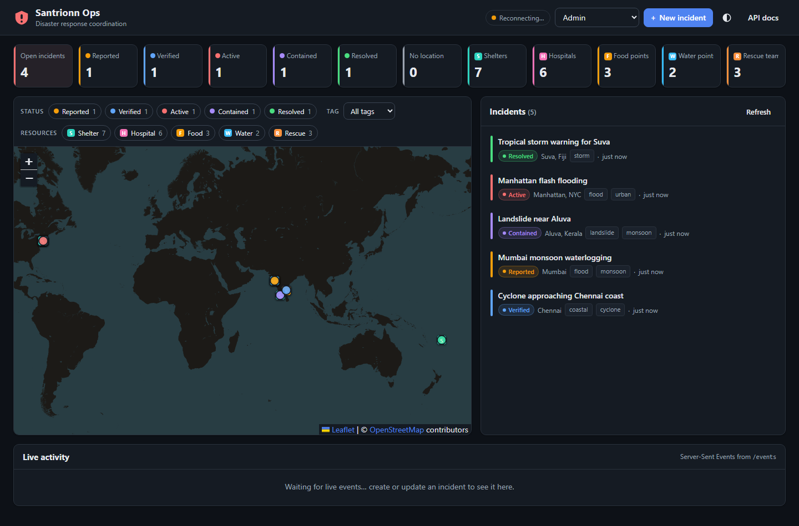

# Disaster Response Coordination Platform

A small, backend-focused API for coordinating disaster response: create incidents, resolve their location
from free text, find nearby resources (shelters, hospitals, water…), pull community reports from an
external social-media service, and push live updates to clients. Incidents follow an explicit
**response lifecycle** with a transactional **audit trail**, and a lightweight **operations dashboard**
(map + incident workspace) sits on top of the API to demonstrate it end to end.



📄 **Design document (PDF):** [`docs/Design-Document.pdf`](docs/Design-Document.pdf). It covers architecture, a file-by-file
walkthrough, the data model, each decision with alternatives considered, request flows, edge cases, testing and the roadmap.

**Stack:** Node.js 20+ · TypeScript · Express 5 · SQLite (better-sqlite3, R\*Tree spatial index) · zod · Server-Sent Events · Vitest + Supertest

> Guiding principle (from the brief): *build less, think deeply*. I kept the feature surface to what was
> asked, and spent the effort on failure handling, data modelling and the edge cases around each feature.

---

## Contents
- [Quick start](#quick-start)
- [Trying it out](#trying-it-out)
- [Architecture](#architecture)
- [API overview](#api-overview)
- [Technical decisions](#technical-decisions)
  - [Incident lifecycle](#incident-lifecycle)
  - [Audit trail](#audit-trail)
  - [Database: why SQLite](#database-why-sqlite)
  - [Geospatial search](#geospatial-search)
  - [Location resolution](#location-resolution)
  - [Caching](#caching)
  - [External API failure handling](#external-api-failure-handling)
  - [Real-time updates](#real-time-updates)
  - [Authentication & authorization](#authentication--authorization)
  - [Validation & errors](#validation--errors)
  - [Request IDs & rate limiting](#request-ids--rate-limiting)
  - [Operations dashboard (frontend)](#operations-dashboard-frontend)
- [Data model](#data-model)
- [Testing](#testing)
- [Assumptions](#assumptions)
- [Trade-offs](#trade-offs)
- [Known limitations & future work](#known-limitations--future-work)
- [AI usage](#ai-usage)

---

## Quick start

Requirements: **Node.js 20+** (developed on Node 24). No database server, Docker or API keys needed.

```bash
npm install
cp .env.example .env        # optional – every setting has a sensible default
npm run seed                # creates ./data/app.db with 21 resources + 5 sample incidents (one per status)
npm run dev                 # http://localhost:3000
```

| URL | What |
|---|---|
| http://localhost:3000/ | **Ops dashboard**: KPIs, map, incident workspace (status actions, nearby resources, reports, history), live feed, role switcher |
| http://localhost:3000/docs.html | Swagger UI (OpenAPI spec in [`docs/openapi.yaml`](docs/openapi.yaml)) |
| http://localhost:3000/events | Raw SSE stream (`curl -N`) |

> An existing `data/app.db` from an earlier version is migrated automatically on startup
> (`PRAGMA user_version`, see [Audit trail](#audit-trail)), so there's no need to delete it.

Other scripts:

```bash
npm test           # run the test suite (in-memory DB, fakes for external services)
npm run typecheck  # tsc --noEmit
npm start          # run without file watching
```

A Postman collection is in [`docs/postman_collection.json`](docs/postman_collection.json)
(run *Create disaster (contributor)* first; it stores `disasterId` for the other requests).
Postman can also import `docs/openapi.yaml` directly.

## Trying it out

Mock users (send as `Authorization: Bearer <token>`):

| Token | User id | Role |
|---|---|---|
| `admin-token` | `admin` | admin |
| `contributor-token` | `contributor1` | contributor |
| `contributor2-token` | `contributor2` | contributor |

```bash
# 1. Watch live events in one terminal
curl -N http://localhost:3000/events

# 2. Create a disaster – location is extracted from the description and geocoded
curl -s -X POST http://localhost:3000/disasters \
  -H "Authorization: Bearer contributor-token" -H "Content-Type: application/json" \
  -d '{"title":"Manhattan flooding","description":"Heavy flooding has affected Manhattan, NYC.","tags":["flood"]}'
# -> "location": {"name":"Manhattan, NYC","lat":40.7831,"lng":-73.9712,"source":"geocoded"}

# 3. Nearby resources (defaults to the disaster's own coordinates)
curl -s "http://localhost:3000/disasters/<id>/resources?radius=5"
curl -s "http://localhost:3000/disasters/<id>/resources?lat=40.7831&lng=-73.9712&radius=25&type=shelter"

# 4. Community reports – call twice and compare the X-Cache header (MISS, then HIT)
curl -si "http://localhost:3000/disasters/<id>/reports" | grep -i x-cache

# 5. Authorization: contributors cannot delete
curl -s -X DELETE http://localhost:3000/disasters/<id> -H "Authorization: Bearer contributor-token"
# -> 403 {"error":{"code":"FORBIDDEN","message":"Requires role: admin"}}
```

Observed locally: first `/reports` call ≈ 400 ms (HTTP call to the mock upstream with simulated latency),
second call ≈ 1 ms (cache hit).

---

## Architecture

```
            HTTP / SSE clients (curl, Postman, Swagger UI, public/index.html)
                                     │
┌────────────────────────────────────▼─────────────────────────────────────┐
│ Express app (src/app.ts – composition root, error handler, auth middleware)│
│                                                                           │
│  routes ──► services (business rules) ──► repositories (SQL) ──► SQLite   │
│  disasters    DisasterService               DisasterRepository   disasters, disaster_tags
│  resources    ResourceService               ResourceRepository   resources + resources_rtree
│  reports      ReportService ─┐                                   external_cache
│                              │                                            │
│  DisasterService ──► LocationResolver ──► Extractor + Geocoder chain      │
│        │                                   Cached(Fallback(Nominatim, Mock))
│        ▼                                                                  │
│     EventBus ──► SSE transport (/events)                                  │
│                                                                           │
│  ReportService ──► ReadThroughCache (memory) ──► HttpSocialMediaClient ───┼──► mock social API
└───────────────────────────────────────────────────────────────────────────┘    (/mock/social, over real HTTP)
```

```
src/
  app.ts                  composition root: wires deps, routes, error handling
  server.ts               process entry: config, real integrations, graceful shutdown
  config.ts               env parsing/validation (fail fast)
  db/                     schema.sql (idempotent), connection
  auth/                   mock users, authenticate / requireRole middleware
  lib/                    errors, validation, cache, fetchJson (timeout+retry), geo math
  integrations/
    geocoding/            extractor, gazetteer, Mock/Nominatim/Fallback/Cached geocoders, LocationResolver
    social/               HTTP client + normaliser, mock upstream service
  modules/
    disasters/            types, zod schemas, repository, service, routes
    resources/            geospatial search
    reports/              reports service + priority classifier
  realtime/               EventBus, SSE router
scripts/seed.ts           demo data
tests/                    API, business rules, geo, cache, integrations, SSE
```

Layering rules I followed:
- **Routes** only parse/validate input and shape HTTP responses.
- **Services** hold business rules (ownership, status transitions, when to re-geocode) and are HTTP-agnostic.
- **Repositories** are the only place with SQL.
- **Integrations** sit behind small interfaces (`Geocoder`, `LocationExtractor`, `SocialMediaClient`), so
  `createApp()` receives them as dependencies and tests swap in fakes; no module mocking needed.

---

## API overview

| Method | Path | Auth | Notes |
|---|---|---|---|
| POST | `/disasters` | admin, contributor | location resolved automatically |
| GET | `/disasters` | public | `?tag=&status=&created_by=&limit=&offset=` |
| GET | `/disasters/:id` | public | |
| PATCH | `/disasters/:id` | admin (any) / contributor (own) | partial update; status changes must follow the lifecycle (409 otherwise) |
| DELETE | `/disasters/:id` | admin | soft delete, 204 |
| GET | `/disasters/:id/history` | public | audit trail, newest first |
| GET | `/lifecycle` | public | statuses + allowed transitions (drives the UI's action buttons) |
| GET | `/stats` | public | counts per status / resource type (dashboard KPIs) |
| GET | `/disasters/:id/resources` | public | `?lat=&lng=&radius=(km, ≤200)&type=&limit=` |
| GET | `/disasters/:id/reports` | public | `?priority=high\|medium\|low`; `X-Cache` header |
| GET / POST | `/resources` | public / admin | resource catalogue |
| GET | `/events` | public | SSE: `disaster_created`, `disaster_updated`, `disaster_deleted` |
| GET | `/health` | public | |

Full request/response schemas: [`docs/openapi.yaml`](docs/openapi.yaml) (rendered at `/docs.html`).

Error envelope (every error, including 404 for unknown routes and malformed JSON). Every response also
carries an `X-Request-Id` header, and errors repeat it as `request_id` so a user report can be matched to a log line:

```json
{ "error": { "code": "VALIDATION_ERROR", "message": "Request validation failed",
             "details": [{ "field": "lat", "message": "Too big: expected number to be <=90" }],
             "request_id": "8cba542f-df09-4b06-b1e7-493571e2a01d" } }
```

| Status | Code(s) |
|---|---|
| 400 | `VALIDATION_ERROR`, `INVALID_JSON` |
| 401 | `UNAUTHORIZED` |
| 403 | `FORBIDDEN` |
| 404 | `NOT_FOUND` |
| 409 | `INVALID_STATUS_TRANSITION` (details: `from`, `to`, `allowed`) |
| 413 | `PAYLOAD_TOO_LARGE` |
| 422 | `LOCATION_UNRESOLVED` (nearby search without any coordinates) |
| 429 | `RATE_LIMITED` (with `Retry-After`) |
| 503 | `UPSTREAM_UNAVAILABLE` (reports upstream down and nothing cached) |
| 500 | `INTERNAL_ERROR` (details logged server-side, never leaked) |

---

## Technical decisions

### Incident lifecycle

A disaster's status isn't free text. It moves through an explicit response workflow, defined **once, as data**
in `src/modules/disasters/lifecycle.ts`:

```
reported ──► verified ──► active ◄──► contained
    │            │           │            │
    └────────────┴───────────┴────────────┴──► resolved ──(admin only)──► active
```

- `resolved` is reachable from every open state (early on, it means *false alarm / duplicate*).
- A new incident may start as `reported`, `verified` or `active`, never already `contained`/`resolved` (400).
- An illegal move returns **409 `INVALID_STATUS_TRANSITION`** with the allowed next states in `details.allowed`.
  It's 409 rather than 400 because the request is well-formed; it conflicts with the resource's *current state*.
- Check order on PATCH: ownership (403) → reopening needs admin (403) → transition table (409). That way a
  contributor gets the more useful "ask an admin" message, not a list of moves they can't use anyway.
- `GET /lifecycle` publishes the same table, so the dashboard renders only valid buttons instead of
  duplicating the rules. The backend stays the enforcer.

### Audit trail

Every change to a disaster writes a row to `disaster_events` (`created`, `updated`, `status_changed`,
`deleted`) with the actor, timestamp and a **field-level diff**, e.g. `{"status": {"from": "reported", "to": "verified"}}`.
It's exposed at `GET /disasters/:id/history` and shown as a timeline in the dashboard.

- **Atomic:** the audit row is written in the **same SQLite transaction** as the change it describes, so an entry
  exists *if and only if* the change committed. A test forces the audit insert to fail and asserts the update rolls back.
- **No-op PATCH** (nothing actually changed): no audit row, no `updated_at` bump, no SSE event.
- Tags are diffed as sets (order carries no meaning). Location changes are recorded per sub-field.
- The table is append-only, and its monotonic ids give a total order even when timestamps are equal.

**Schema migration.** Adding `verified` widens a `CHECK` constraint, which SQLite can't alter in place.
`db/connection.ts` tracks a schema version in `PRAGMA user_version`. For older databases it rebuilds the
`disasters` table inside a transaction, using SQLite's documented table-rebuild procedure:
- Foreign keys are temporarily off, so the tag rows aren't cascade-deleted.
- A `foreign_key_check` runs at the end.
- `schema.sql` stays the single source of DDL.

Covered by `tests/migration.test.ts`.

### Database: why SQLite

I chose **SQLite** via `better-sqlite3`:

- **Zero setup for reviewers:** `npm install` and it runs. No Docker or Postgres to provision, which matters for a take-home with a 48-hour window.
- **A real spatial index:** SQLite ships the **R\*Tree** module, so geospatial search is index-backed, not a full scan.
- **Relational modelling:** foreign keys, `CHECK` constraints, partial indexes and transactions are all available, so the schema enforces invariants instead of trusting application code.
- **Synchronous driver:** better-sqlite3 is synchronous and very fast for a single-node service, which keeps repository code simple.

**What I'd use in production: PostgreSQL + PostGIS.** I'd store a `geography(Point, 4326)` column with a GiST
index and query with `ST_DWithin(location, ST_MakePoint(lng, lat)::geography, radius_m)` ordered by
`location <-> point`. The repository layer is the only code that would change. SQLite's limits here are a
single writer and a single node, which is fine for this scope but not for a multi-instance deployment.

### Geospatial search

`GET /disasters/:id/resources?lat&lng&radius` runs a **two-phase search**:

1. **Index pre-filter (R\*Tree).** Each resource is stored in `resources_rtree` as a degenerate box
   (`min_lat = max_lat = lat`, same for lng), kept in sync by `INSERT/UPDATE/DELETE` triggers. I compute a
   bounding box that encloses the search circle:
   `Δlat = r / 111.32 km`, `Δlng = r / (111.32 km · cos(lat))`, and query the R\*Tree for points inside the box.
   This is an index range lookup, roughly O(log n + k).
2. **Exact filter.** For the small candidate set I compute the **haversine** great-circle distance, drop
   points outside the radius (the box's corners are outside the circle), sort by distance and apply `limit`.
   Each result includes `distance_km`.

Edge cases handled (and tested):
- **Antimeridian:** a circle crossing ±180° (e.g. Fiji) is split into two boxes, and results are merged/deduplicated.
- **Poles:** near a pole the longitude span degenerates, so the search covers all longitudes.
- **Search centre:** explicit `lat`/`lng` if given (both or neither, else 400). Otherwise the disaster's
  resolved coordinates. If the disaster is unresolved, the API returns **422 `LOCATION_UNRESOLVED`** with a hint, not an empty list that looks like "no resources".
- `radius` must be > 0 and ≤ 200 km (bounds the candidate set). `type` is an enum filter.
- R\*Tree stores 32-bit floats. That only matters for the coarse box (which SQLite rounds outward); the exact check uses the original double-precision columns.

Resources are modelled **independently of disasters**: a hospital exists regardless of any incident, and the
same shelter can serve several incidents. The disaster only supplies the default search centre.

### Location resolution

`LocationResolver` decides where a disaster is, in priority order:

1. **Client coordinates** (`lat`+`lng`): trusted as-is, `source: "client"`.
2. **`location_name`**, or a place **extracted from the description**, geocoded: `source: "geocoded"`.
3. Nothing found or the geocoder is down: `source: "unresolved"` (coordinates `null`).

**Creating a disaster never fails because geocoding failed.** Recording the incident is more important than
having coordinates immediately, and `location.source` makes the state explicit to clients.

- **Extraction** (`RuleBasedLocationExtractor`) is deterministic. It takes the first capitalised phrase after a location cue
  (`in`, `near`, `affected`, `hit`…), e.g. *"Heavy flooding has affected **Manhattan, NYC**."*, and falls back to
  scanning for known place names (handles lowercase text). It sits behind a `LocationExtractor` interface,
  so an LLM/NER extractor can replace it without touching callers.
- **Geocoding** is a decorator chain: `CachedGeocoder( FallbackGeocoder( NominatimGeocoder, MockGeocoder ) )`.
  - `GEOCODER=mock` (default) uses an offline gazetteer, so it works with no network or keys.
  - `GEOCODER=nominatim` uses OpenStreetMap Nominatim (keyless) and falls back to the gazetteer on error or no result.
  - For `"Manhattan, NYC"` the gazetteer tries the full string, then each comma part (most specific first).
- **On PATCH**, location is re-resolved only when it could have changed: new coordinates, a new
  `location_name`, or a new description (unless the client pinned coordinates). If a new description names no
  place, the previous location is kept. This avoids needless geocoding calls.

### Caching

| What | Store | TTL | Key | Why |
|---|---|---|---|---|
| Community reports (social API) | in-memory, bounded (500 entries, LRU-ish) | 60 s (`REPORTS_CACHE_TTL_SECONDS`) | `reports:<normalised query>` | reports are time-sensitive; one minute is fresh enough for a dashboard and absorbs bursts |
| Geocoding results | SQLite `external_cache` table (survives restarts) | 7 days positive / 1 h negative | `geo:<provider>:<normalised place>` | places don't move; negative results are cached briefly so typos don't hammer the provider |

Both use one `ReadThroughCache` that implements the required flow, plus two refinements:

```
request → cache lookup ──fresh──► HIT  (return)
              │ missing/expired
              ▼
       in-flight request for this key? ──yes──► await the same promise   (request coalescing)
              │ no
              ▼
       call upstream ──ok──► store {value, storedAt, expiresAt} ──► MISS (return)
              │ fails
              ▼
       expired entry exists? ──yes──► STALE (return old value)          (stale-if-error)
              │ no
              ▼
       error → 503 UPSTREAM_UNAVAILABLE
```

- **Request coalescing:** ten concurrent requests for a cold key cause one upstream call, which prevents a stampede when a popular incident's cache expires.
- **Stale-if-error:** entries are kept past their TTL, so during an upstream outage clients get slightly old data (marked `X-Cache: STALE` with `meta.fetched_at`) instead of an error.
- Reports are keyed by the **upstream query** (the disaster's location name), not the disaster id, so several incidents in the same place share one upstream call.
- Priority classification runs **after** the cache (it's cheap), so rule changes take effect without waiting for expiry.

Trade-off: the in-memory cache is per-process. With several instances I'd move it to **Redis**. The
`CacheStore` interface is two methods, and the SQLite store shows a second implementation already plugs in.

### External API failure handling

All outbound HTTP goes through `fetchJson()`:
- **Per-attempt timeout** (`AbortSignal.timeout`, default 3 s). A hung upstream can't hold a request open.
- **Bounded retries with exponential backoff** (default 2 retries, 200 ms → 400 ms), **only for retryable failures**: network errors, timeouts, 429 and 5xx. A 4xx is not retried, because repeating a bad request won't fix it.
- Failures become a typed `ExternalServiceError` (service, status, retryable), never a raw exception.

Then each feature decides how to degrade:

| Integration | On failure |
|---|---|
| Geocoder | fall back to the gazetteer, then store the disaster as `unresolved` (creation still succeeds) |
| Social media | serve stale cache if available, otherwise **503** with a retryable message |

**Normalisation:** the mock upstream returns a deliberately different shape
(`{ statuses: [{ id_str, text, author: { handle }, timestamp_ms }] }`). `normalizePosts` maps it to
`{ id, content, user, created_at, source }`, **drops malformed items individually** (and logs a count) instead of failing the whole response,
and tolerates a completely unexpected payload (returns `[]`).

The mock social service (`/mock/social/posts`) is called over **real HTTP**, adds latency (`SOCIAL_MOCK_LATENCY_MS`),
fails randomly (`SOCIAL_MOCK_FAILURE_RATE`, default 20%, which the retries usually absorb) and includes a malformed post,
so the failure paths are exercised in normal use, not only in tests. Set `SOCIAL_API_URL` to point at a different upstream.

### Real-time updates

I used **Server-Sent Events** at `GET /events`:
- Updates are one-way (server → client), so WebSockets' bidirectionality isn't needed.
- SSE is plain HTTP: it works through proxies, needs no extra library, and `EventSource` reconnects automatically (`retry: 3000`).
- Events: `disaster_created`, `disaster_updated`, `disaster_deleted`, each carrying `{ type, disaster, actor, at }`. A `?disaster_id=` filter follows a single incident.
- A heartbeat comment every 25 s keeps idle connections alive through load balancers. Listeners are removed when the client disconnects (no leaks), and shutdown closes open streams.

Services publish to an in-process **`EventBus`** and know nothing about SSE. To scale horizontally, the bus
would be backed by Redis pub/sub (or Postgres `LISTEN/NOTIFY`) so every instance fans out every event, with no change to services.

Demo: open http://localhost:3000/ and create a disaster. There's also an automated test (`tests/realtime.test.ts`) that opens the stream and asserts on the events.

### Authentication & authorization

- **Authentication:** `Authorization: Bearer <token>` checked against a mock user table (`src/auth/users.ts`).
  These tokens are intentionally public demo values, not secrets.
- **Authorization:** two layers.
  - Route-level **roles** (`requireRole`): who may call an endpoint at all.
  - Service-level **resource rules**: what this user may do to this particular record.

| Action | admin | contributor |
|---|---|---|
| Read disasters/resources/reports | ✅ | ✅ (also anonymous) |
| Create disaster | ✅ | ✅ |
| Update disaster | ✅ any | ✅ **only ones they created** |
| Reopen a `resolved` disaster | ✅ | ❌ |
| Delete disaster | ✅ | ❌ |
| Create resource | ✅ | ❌ |

`created_by` always comes from the authenticated user. Sending it in the body is rejected (strict schemas),
so a user cannot create records on someone else's behalf.

### Validation & errors

- **zod** schemas per endpoint. They're **strict** (unknown fields → 400), so typos like `stauts` don't fail silently.
- Normalisation happens during validation: strings are trimmed, tags lower-cased and deduplicated (`["Flood","flood"]` → `["flood"]`).
- Cross-field rules: `lat`/`lng` must be sent together, and PATCH must contain at least one field.
- Query parameters are coerced and bounded (`limit ≤ 100`, `radius ≤ 200`).
- The database repeats the critical invariants as `CHECK` constraints (enums, coordinate ranges, both-or-neither coordinates), as a last line of defence.
- One error middleware produces the envelope. Unknown errors are logged and returned as a generic 500, so stack traces never reach clients.
- The JSON body limit is 100 kB (→ 413).
- Configuration is validated at startup (`config.ts`), so a bad env var fails fast instead of at first use.

### Request IDs & rate limiting

- **Request IDs:** each request gets an id. A well-formed incoming `X-Request-Id` is reused, so one operation keeps
  one id across services; otherwise it's a UUID. The id is returned as a header, included in every error body, and
  prefixes every log line, so "it failed for me" reports are traceable.
- **Rate limiting:** writes (POST/PATCH/PUT/DELETE) are limited per user (or per IP when anonymous) with a small
  fixed-window counter: `RATE_LIMIT_WRITES_PER_MINUTE`, default 60. Exceeding it returns **429** with `Retry-After`.
  - Reads are not limited: during an incident, people need to read freely.
  - The counter is in-memory, which is fine for one node; expired windows are swept so memory stays bounded.
  - With several instances it would move to Redis (`INCR` + `EXPIRE`) behind the same interface.

### Operations dashboard (frontend)

The brief says a polished frontend isn't required, so I kept it deliberately **thin**:
- One page (`public/index.html` + `app.js` + `styles.css`), plain ES modules.
- **No build step and no npm dependencies.** Leaflet for the map comes from a CDN.
- It uses the same public API as any other client, with no private endpoints, so it also shows the API is sufficient.

What it does:
- **KPIs** from `GET /stats`.
- **Map:** incidents coloured by status, resources by type. The filter chips double as the legend.
- **Radius search:** selecting an incident draws the search radius (with a slider) and highlights resources from `/disasters/:id/resources`.
- **Incident workspace:**
  - overview
  - lifecycle action buttons from `/lifecycle`
  - nearby resources
  - community reports, with a priority filter, the cache status and a retry button on 503
  - the **audit history** timeline
- **Role switcher** (Admin / Contributor 1 / Contributor 2 / Viewer). The UI hides actions a role can't take, but
  always shows the API's own 401/403/409 message, because the server is the authority.
- **Live:** an `EventSource` on `/events` updates markers, list, KPIs and the open incident in place, and resyncs after a reconnect.
- API strings are never injected as HTML (all DOM is built from text nodes), so incident titles can't inject script.
- Responsive down to 375px, with light/dark themes.

---

## Data model

```
disasters                                   disaster_tags                 resources                    resources_rtree (virtual)
─────────────────────────────               ───────────────────           ──────────────────────       ─────────────────────────
id            TEXT PK (UUID)        1 ──── * disaster_id FK → disasters   id         INTEGER PK  1 ── 1 id
title         TEXT                          tag         TEXT              name       TEXT              min_lat, max_lat
description   TEXT                          PK(disaster_id, tag)          type       TEXT (enum)       min_lng, max_lng
location_name TEXT NULL                     IDX(tag, disaster_id)         location_name TEXT NULL      (synced by triggers)
lat, lng      REAL NULL (both or neither)                                 lat, lng   REAL
location_source  client|geocoded|unresolved                               created_at TEXT
status        reported|verified|active|contained|resolved                                                        external_cache
created_by    TEXT                                                                                      key PK, value JSON, expires_at
created_at, updated_at  TEXT (ISO-8601 UTC)
deleted_at    TEXT NULL  (soft delete)

disaster_events (audit trail)
──────────────────────────────
id          INTEGER PK AUTOINCREMENT
disaster_id FK → disasters
action      created|updated|status_changed|deleted
actor       TEXT
changes     JSON  { field: { from, to } }
at          TEXT
IDX(disaster_id, id)
```

Design notes:
- **Tags get their own table**, not a JSON/CSV column. `?tag=flood` becomes an indexed lookup on `(tag, disaster_id)` instead of a `LIKE` scan, and it stays correct (no `flood` matching `flash-flood`). Listing aggregates tags in the same query with `json_group_array`, so there's no N+1.
- **`location_source`** records how coordinates were obtained, so clients and operators can tell trusted coordinates from best-effort ones.
- **Soft delete:** incident history is valuable for audit and post-incident review, so DELETE sets `deleted_at` and every read filters on it. Partial indexes (`WHERE deleted_at IS NULL`) keep the live set fast.
- **Status lifecycle:** enforced as a state machine (see [Incident lifecycle](#incident-lifecycle)).
- UUIDs for disasters (safe to expose, not enumerable). Integer ids for resources, because the R\*Tree requires them.

---

## Testing

```bash
npm test
```

70 tests across 9 files run in ~2 s against an in-memory SQLite database, with fakes injected for external services:

| Requirement | Where |
|---|---|
| API endpoints | `tests/disasters.test.ts`: create/list/filter/paginate/get/patch/delete over HTTP (supertest) |
| Validation / error scenarios | field-level 400s, unknown fields, lone `lat`, malformed JSON, 401, 404, 422, 503 |
| Business rules | contributor can't delete; contributors edit only their own; lifecycle transitions (valid path, 409 on invalid, admin-only reopen); soft delete; re-geocoding on description change |
| Audit & migration | `tests/audit.test.ts`: ordered history with diffs and actors, no-op PATCH writes nothing, rollback when the audit insert fails; `tests/migration.test.ts`: old schema migrates with rows, tags and FKs intact, and a second run changes nothing |
| Platform | `tests/platform.test.ts`: request id echo/generation, 429 + `Retry-After` on writes only, `/stats` counts |
| External integration / mocks | `tests/integrations.test.ts`: geocoder fallback, persistent geocode cache, `fetchJson` retries 5xx but not 4xx (real local HTTP server); `tests/reports.test.ts`: normalisation drops malformed posts, cache HIT/MISS, stale-if-error, request coalescing, 503 when upstream down |
| Geospatial | `tests/resources.test.ts`: radius filter, ordering, box-corner exclusion, type filter, antimeridian, poles |
| Real-time | `tests/realtime.test.ts`: opens a real SSE connection and asserts `disaster_created` / `disaster_updated` |

The cache takes an injectable clock, so TTL expiry is tested without sleeping.

---

## Assumptions

- **Location** is a single point per disaster. Affected areas (polygons) are out of scope.
- `radius` is in **kilometres**. If `lat`/`lng` are omitted, the disaster's location is the centre.
- Resources are a shared catalogue, not owned by a disaster.
- Reads are public: in a disaster, situational information should be widely accessible. Writes require auth.
- "Contributor → create/update" means **update their own** disasters. Letting any volunteer edit any incident seemed unsafe.
- Community reports are matched by place name (what a social-media search would use), not by disaster id.
- Times are stored and returned as UTC ISO-8601.

## Trade-offs

| Decision | Gained | Gave up |
|---|---|---|
| SQLite + R\*Tree instead of Postgres/PostGIS | zero-setup, real spatial index, fast tests | single writer/node; no `ST_DWithin`/KNN operator; manual bbox maths |
| Rule-based location extraction | deterministic, free, testable, offline | misses unusual phrasing; an LLM would be more robust |
| In-memory cache for reports | simple, no infra | per-process; lost on restart; not shared across instances |
| SSE instead of WebSockets | simplest correct tool for one-way push; auto-reconnect | no client→server messages (not needed) |
| Mock bearer tokens | focus on authorization *rules* | no real identity, expiry or signing |
| Vanilla JS dashboard instead of React/Next.js | zero build, nothing to install, reviewers open one URL | less structure if the UI grew; would move to a framework then |
| In-memory rate limiter | no infra | per-process counts; Redis for multi-node |
| Offset pagination | simple | can skip/duplicate rows under concurrent inserts; cursor pagination would fix it |
| `tsx` runs TypeScript directly (no build step) | simpler setup | slightly slower cold start than precompiled JS |
| Keyword priority classifier (bonus) | explainable, instant | not semantic ("my house is fine, no help needed" → medium) |

## Known limitations & future work

- **Auth:** replace mock tokens with an identity provider (OIDC/JWT). Move the rate limiter to Redis, and also limit `/reports` (it fans out to an upstream).
- **Scale-out:** Postgres + PostGIS, Redis for the cache, Redis pub/sub behind the `EventBus` so SSE works across instances.
- **Async geocoding:** today geocoding happens inside the create request (bounded by timeout and retries). Better: create immediately as `unresolved`, enqueue a background job, then emit `disaster_updated` when coordinates arrive. The real-time channel is already in place for this.
- **Concurrency control:** PATCH is last-write-wins. Add `ETag`/`If-Match` (optimistic locking on `updated_at`) to prevent lost updates.
- **Migrations tooling:** the hand-written `user_version` migration is fine for one step; more steps would call for a migration runner. Rows created before the audit trail existed have no `created` entry (not backfilled).
- **Duplicate incident detection** (same place, time window and text similarity), and **resource capacity/allocation** with transactional checks against over-allocation.
- **Location extraction:** LLM/NER extractor behind the existing interface; handle multiple locations in one description.
- **Nominatim policy:** respect its 1 req/s limit with a client-side rate limiter if real traffic is expected (the cache already removes most repeats).
- **Observability:** structured logs with request ids, metrics for cache hit ratio and upstream error rate.

---

## AI usage

**Tool:** Claude Code (Anthropic), a terminal-based coding agent.

**How I worked with it:** I treated it as an engineering team that I directed. It wrote the code, tests and
documentation, and ran the verification. My role was setting the direction, making the key decisions, choosing
the scope, and reviewing what it produced.

### Decisions I made

- **Database:** kept SQLite + R\*Tree instead of switching to Supabase/PostgreSQL. Reviewers can run it with one
  command, and switching would have put the deadline at risk. The PostGIS migration path is documented in
  [Trade-offs](#trade-offs).
- **Scope:** chose the extras that show engineering judgement:
  - an incident lifecycle
  - a transactional audit trail
  - request IDs and rate limiting
  - a thin dashboard

  I rejected extras that would only add surface area for this brief: a Next.js rewrite, Redis/queues, Docker and
  LLM-based triage.
- **Delivery order:** shipped a complete, tested baseline (all core requirements) to GitHub first, then iterated on it.

### Extras I asked for beyond the brief

| Request | Result |
|---|---|
| A frontend, so reviewers can experience the system without testing each endpoint by hand | Operations dashboard (`public/`): map, incident workspace, live feed, role switcher |
| Make the system feel engineered rather than CRUD | Incident lifecycle with 409 on invalid transitions, transactional audit trail with `/history`, request IDs, write rate limiting, `/stats` |
| A document for reviewers explaining every choice | [`docs/Design-Document.pdf`](docs/Design-Document.pdf) |
| A video walkthrough of the real project | A 5-minute showcase built from real footage, code, test output and API responses (shared separately due to its size) |
| Plain-language explanations of the assignment and each approach | So I understand and can defend every part of the design |

### Verification

All verification was run by the AI agent, and I reviewed the results:
- the full test suite (70 tests) and the type checker
- end-to-end API checks: create, then nearby resources, then reports (cache MISS → HIT), then the 403 and 409
  paths, then the SSE events
- the schema migration on an existing database
- browser checks of the dashboard
